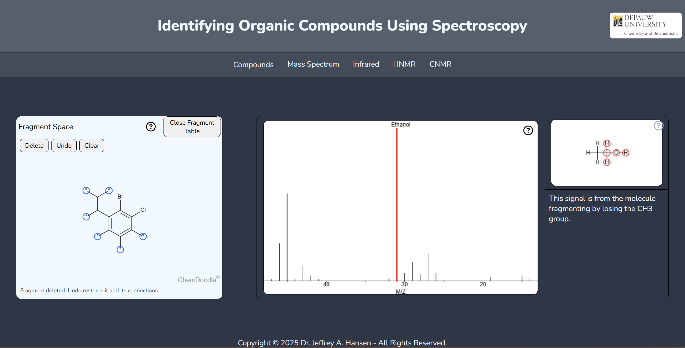
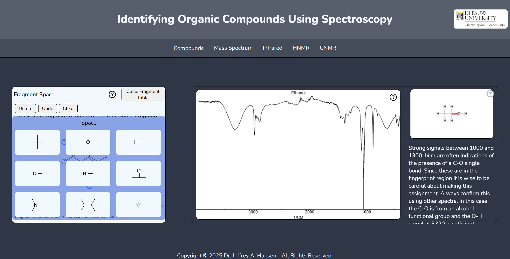

# Interactive Spectroscopy Explorer

> [!WARNING]
> Update ChemDoodle library is NOT recommended: The current library has been modified 

An interactive spectroscopy learning tool for exploring MS, IR, HNMR, and CNMR spectra of selected organic compounds, viewing information and explanations for individual signals, highlighting the corresponding atoms and bonds in molecular structures, and practicing the assembly of corresponding structures in a fragment-based canvas.






## Local setup

### Requirements

- A modern web browser
- Python 3 or another local HTTP server

### Running the project

```bash
git clone https://github.com/biochem-learning/spectrum-app-v2.git
cd spectrum-app-v2
python3 -m http.server 8000
```

On Windows, use:

```powershell
py -m http.server 8000
```

Open the applications in your browser: <http://localhost:8000>

## Acknoledgement

This project uses a modified version of [ChemDoodle Web Components](https://web.chemdoodle.com/) by iChemLabs, licensed under GPLv3.
